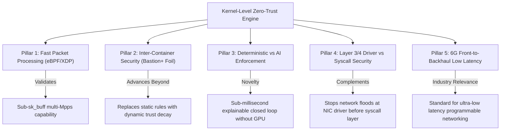
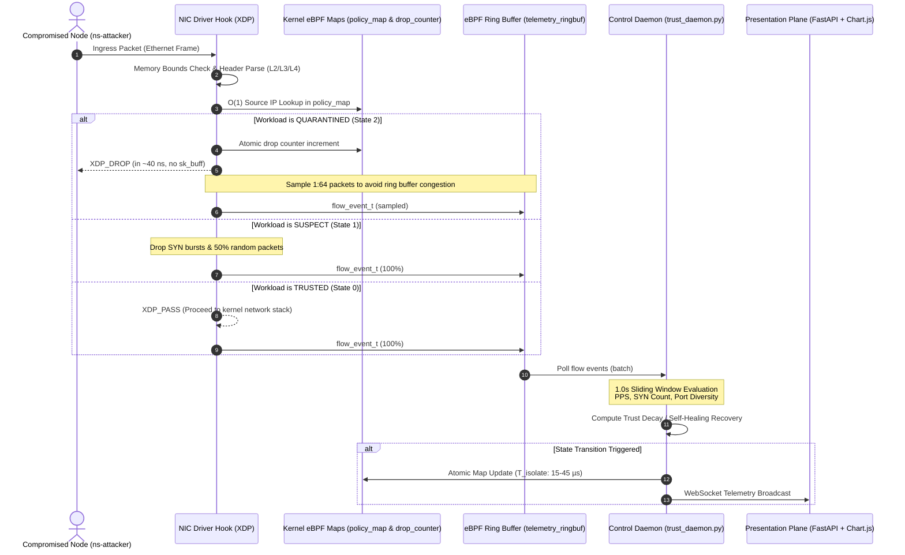

# Kernel-Level Zero-Trust Network Traffic Isolation Engine
## Master Architecture Blueprint, Project Conscience & Future-Centric Execution Guide

> **Academic Context**: Final Year Engineering Capstone Project  
> **Core Technologies**: Linux eBPF, XDP (`xdpgeneric`), BCC (`python3-bpfcc`), Python 3, FastAPI, WebSockets, Chart.js  
> **Team Structure & Responsibilities**:
> - **Project Lead**: Conception, Python Telemetry Daemon, Benchmarking, Project Management
> - **Santhosh K**: Literature Review, Toolchain Setup, Trust Decay State Machine Model
> - **Prithivirajan V**: System Architecture Design, XDP/eBPF Maps, FastAPI & WebSocket Dashboard

---

## 1. Executive Summary & 60-Second Defense Elevator Pitch

### The Core Problem
In cloud, microservice, and multi-tenant container environments, traditional firewalls (`iptables`, `nftables`) and user-space service meshes (Envoy, Istio) suffer from two fatal vulnerabilities:
1. **Resource Asymmetry under Volumetric Flood**: Packets must be processed through NIC hardware interrupts, kernel socket buffer (`sk_buff`) allocation, and connection tracking (`nf_conntrack`) before firewall filtering occurs. Under volumetric floods (SYN, UDP, ICMP), CPU cores saturate at 100% processing packet overhead (`ksoftirqd`), starving application workloads.
2. **Perimeter-Only Trust & East-West Blindness**: Perimeter firewalls only filter North-South traffic. Once an attacker breaches a container via an application flaw (e.g., Log4j, RCE), internal bridge traffic (`docker0`, CNI bridges) is implicitly trusted, allowing unimpeded lateral movement and reconnaissance.

### The 60-Second Defense Elevator Pitch (For Viva & Faculty Examination)
> *"In modern cloud and containerized environments, traditional firewalls like iptables and user-space proxies fail under load—consuming excessive CPU cycles and reacting too slowly to stop lateral movement. Our project solves this by introducing a kernel-level Zero-Trust Traffic Isolation Engine powered by eBPF and XDP. Instead of allowing malicious packets to enter the Linux networking stack, our system inspects and enforces security policies directly at the NIC driver level, dropping unwanted traffic in nanoseconds before the kernel even allocates memory buffers.*
> 
> *We pair this raw performance with dynamic intelligence: a user-space Python daemon continuously analyzes flow telemetry via an eBPF Ring Buffer to calculate real-time trust scores, updating kernel-space eBPF maps atomically in under a millisecond. This neutralizes volumetric DDoS floods with flat CPU usage, prevents inter-container lateral movement, and dynamically quarantines reconnaissance and port scans—all without restarting services, reloading firewall rules, or disrupting legitimate workloads. We deliver intelligence in user space and enforcement at wire speed in the kernel."*

---

## 2. Core Theoretical Fundamentals & Intuitive Mechanics

### 2.1 The Office Building Security Analogy
- **Traditional Firewall (`iptables`)**: A visitor enters a high-security office building. The front desk allows them into the lobby, prepares a physical visitor badge, creates an administrative folder, and assigns an escort. Only after all this effort does a security officer check the blacklist and escort trespassers out. Under a crowd surge, the lobby fills and the entire building shuts down.
- **XDP (eXpress Data Path)**: Acts as the **Outer Parking Lot Security Gate**. The packet is inspected at the earliest possible physical boundary before entering the lobby (kernel memory) and turned away in nanoseconds (`XDP_DROP`).
- **eBPF (Extended Berkeley Packet Filter)**: Acts as the **Guard's Synchronized Digital Tablet**. A safe, in-kernel programmable engine with shared memory tables (eBPF Maps) allowing instantaneous lookup of dynamic trust scores and atomic blocklist mutations.

### 2.2 Deep Technical Mechanics
- **In-Kernel eBPF Virtual Machine**: Register-based sandboxed VM inside the Linux kernel. Programs are written in restricted C, compiled to bytecode via Clang/LLVM, and executed safely without kernel recompilation.
- **eBPF Verifier (Safety Contract)**: Guarantees memory safety and finite execution. Enforces Directed Acyclic Graph (DAG) structures (no unbounded loops) and **strict pointer bounds checks** before header access:
  ```c
  if ((void *)(eth + 1) > data_end) return XDP_PASS;
  if ((void *)(ip + 1) > data_end) return XDP_PASS;
  if ((void *)(tcp + 1) > data_end) return XDP_PASS;
  ```
- **XDP Verdicts**:
  - `XDP_DROP`: Recycles the RX ring page immediately (~40 nanoseconds); bypasses `sk_buff` allocation.
  - `XDP_PASS`: Forwards packet up into Linux networking stack.
  - `XDP_TX`: Reflects packet out through the same NIC.
  - `XDP_REDIRECT`: Shunts frame to another interface or CPU core.
- **Shared eBPF Maps**: Concurrent key-value stores (`BPF_HASH`) for $O(1)$ IP lookups and lockless circular buffers (`BPF_RINGBUF_OUTPUT`) streaming flow telemetry to user space.

---

## 3. Comparative Architecture Matrix

| Dimension | Legacy Firewalls (`iptables` / `nftables`) | User-Space Proxies (Envoy / Istio) | Kernel Bypass (DPDK) | Static XDP Filters (Bastion+) | Proposed Dynamic eBPF/XDP Engine |
| :--- | :--- | :--- | :--- | :--- | :--- |
| **Inspection Hook** | Netfilter (post-`sk_buff`) | User socket (multiple context switches) | Full user-space polling (bypasses kernel) | NIC driver (XDP hook) | **NIC driver (XDP hook) + User Ringbuf** |
| **Lookup Complexity** | $O(N)$ linear rule traversal | $O(1)$ or $O(\log N)$ in user space | Custom C tables | $O(1)$ static eBPF map | **$O(1)$ dynamic eBPF Hash Map** |
| **DDoS CPU Load** | 100% saturation (softirq) | High (proxy thread starvation) | 100% CPU polling (dedicated core) | Near-flat (event-driven) | **Near-flat (event-driven + 1:64 quarantine sampling)** |
| **Mutation Latency** | Multi-ms (table lock & reload) | Medium (xDS propagation) | Custom control plane | Static pre-configured rules | **Sub-millisecond ($15\text{--}45\,\mu\text{s}$ atomic update)** |
| **Adaptivity** | None (static rules) | L7 policy only | None natively | Binary allow/deny | **3-Tier Dynamic Trust Decay & Self-Healing** |
| **Linux Integration** | Native | Complex iptables redirection | Breaks standard Linux stack | Native | **Native Linux stack + Real-Time WebSocket UI** |

---

## 4. Academic Positioning & Literature Review Mapping

Our project is contextualized by five foundational pillars derived from core research literature:



---

## 5. Three-Plane System Architecture & Packet Lifecycle



---

## 6. Multi-Tier Trust Decay & Self-Healing State Machine

### 6.1 State Definitions

| State Tier | State ID | Trust Score Range ($T$) | Kernel XDP Verdict | Behavioral Trigger Condition |
| :--- | :---: | :---: | :--- | :--- |
| **`TRUSTED`** | `0` | $70.0 \le T \le 100.0$ | `XDP_PASS` (100% line rate) | Workload exhibits normal baseline traffic ($<80\,\text{pps}$, $<25\,\text{SYNs/s}$, $\le 6\,\text{ports/s}$). |
| **`SUSPECT`** | `1` | $30.0 \le T < 70.0$ | Probabilistic Rate-Limit (Drop 50% & SYN bursts) | Mild anomaly detected. Throttles traffic to safeguard victim while evaluating if spike is transient. |
| **`QUARANTINED`** | `2` | $0.0 \le T < 30.0$ | `XDP_DROP` (Zero `sk_buff` allocation) | Sustained volumetric flood (`hping3`) or aggressive port scan (`nmap`). 100% isolated at driver hook. |

### 6.2 Mathematical Formulation
For every sliding window $\Delta t = 1.0\,\text{second}$:
1. **Volumetric Flood Penalty ($P_{\text{pps}}$)**:
   $$P_{\text{pps}}(t) = \min\left(45.0,\; \max(0, \text{PPS}(t) - 80) \times 0.15\right)$$
2. **TCP SYN Flood Penalty ($P_{\text{syn}}$)**:
   $$P_{\text{syn}}(t) = \min\left(50.0,\; \max(0, \text{SYN-Count}(t) - 25) \times 0.45\right)$$
3. **Port Scan / Reconnaissance Penalty ($P_{\text{scan}}$)**:
   $$P_{\text{scan}}(t) = \min\left(60.0,\; \max(0, \text{Unique-Ports}(t) - 6) \times 4.50\right)$$
4. **Aggregate Penalty ($P_{\text{total}}$)**:
   $$P_{\text{total}}(t) = P_{\text{pps}}(t) + P_{\text{syn}}(t) + P_{\text{scan}}(t)$$
5. **Trust Score Update & Self-Healing**:
   $$\text{Trust}(t + \Delta t) = \begin{cases} \max\left(0.0,\; \text{Trust}(t) - P_{\text{total}}(t)\right) & \text{if } P_{\text{total}}(t) > 0 \\ \min\left(100.0,\; \text{Trust}(t) + R_{\text{heal}} \times \Delta t\right) & \text{if } P_{\text{total}}(t) = 0 \end{cases}$$
   *(where $R_{\text{heal}} = +6.0\,\text{points/sec}$ auto-recovery constant)*

---

## 7. Master Phase-by-Phase Execution Roadmap

```text
Phase 0: Environment & VM Tuning
└── [Status: COMPLETE] Ubuntu 22.04 LTS, Clang, LLVM, BCC (python3-bpfcc), FastAPI, Uvicorn, iproute2

Phase 1: 3-Node Virtual Testbed & Static XDP Driver Enforcement
├── Step 1: 3-Node Network Namespace Topology (`setup_netns.sh`)   --> [STATUS: VERIFIED OK]
├── Step 2: Static XDP C Program (`xdp_isolation_p1.c`)            --> [STATUS: CREATED - READY]
├── Step 3: BCC Python CLI Controller (`phase1_loader.py`)         --> [STATUS: CREATED - READY]
└── Step 4: Multi-Terminal Manual Verification                      --> [STATUS: PENDING USER RUN]

Phase 2: Ring Buffer Telemetry & Dynamic Trust Decay Engine
├── Step 1: Dynamic XDP C Program with Ringbuf (`xdp_isolation_p2.c`)
├── Step 2: User-Space Trust Decay Daemon (`trust_daemon.py`)
└── Step 3: End-to-End Live Attack Simulation (nmap + hping3)

Phase 3: Real-Time Observability Presentation Plane
├── Step 1: FastAPI Backend with WebSocket Broadcaster (`dashboard/app.py`)
└── Step 2: Responsive HTML5/Tailwind/Chart.js Dashboard (`dashboard/static/index.html`)

Phase 4: Quantitative Benchmarking & Evaluation
├── Experiment 1: Policy Mutation Latency (T_isolate in µs)
├── Experiment 2: DDoS CPU Survivability (XDP_DROP vs iptables DROP)
├── Experiment 3: Legitimate Workload Preservation (iperf3 baseline)
└── Step 4: Automated Benchmarking Suite (`benchmarks/run_benchmarks.sh`)
```

---

## 8. Quantitative Benchmarking Blueprint (For Thesis & Publication)

| Experiment | Metric & Unit | Measurement Method | Expected Research Outcome |
| :--- | :--- | :--- | :--- |
| **Exp 1: Mitigation Latency ($T_{\text{isolate}}$)** | Microseconds ($\mu\text{s}$) | Measured via `time.perf_counter_ns()` in `trust_daemon.py` during map mutation vs `iptables -A INPUT -s ... -j DROP`. | eBPF atomic map update completes in **$15\text{--}45\,\mu\text{s}$** ($0.015\text{--}0.045\,\text{ms}$) vs **$3,000\text{--}12,000\,\mu\text{s}$** for `iptables` rule reload. |
| **Exp 2: DDoS CPU Survivability** | CPU Utilization (%) | `hping3 -S -p 80 --flood 10.10.0.10` from `ns-attacker` for 30s; log CPU utilization via `psutil`/`mpstat` comparing `iptables DROP` vs `XDP_DROP`. | `XDP_DROP` maintains **flat CPU usage** (<10%) because frames are discarded before `sk_buff` and `nf_conntrack` processing. |
| **Exp 3: Legitimate Throughput Preservation** | Throughput (Gbps/Mbps) & Ping RTT (ms) | Run `iperf3 -c 10.10.0.10 -t 30` and `ping 10.10.0.10` from `ns-legit` during an active flood from `ns-attacker`. | Once attacker is quarantined (<1s), legitimate traffic achieves **~100% baseline throughput** with **0% packet loss** and stable sub-millisecond RTT. |

---

## 9. Living Conscience & Rules for Future Agents

1. **Orientation**: When waking up in this workspace, always inspect `AGENTS.md` and `PROJECT_MASTER_GUIDE.md` first.
2. **User Runs Verification**: The user runs tests, pings, loaders, and attacks in their own terminal tabs. The agent authors code, ensures verifier safety, and provides exact command sequences.
3. **Restricted C & Verifier Safety**: Every header pointer (`eth`, `ip`, `tcp`, `udp`) must be bounds-checked against `ctx->data_end`.
4. **Interface Modes**: Always use `BPF.XDP_FLAGS_SKB_MODE` for virtual bridge `br-xdp` and `veth` interfaces.
5. **No Shell History Expansion**: Avoid `!` inside double-quoted bash strings.
